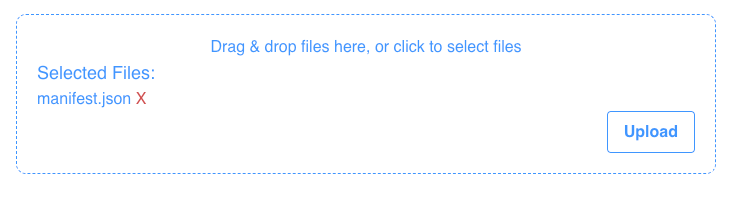
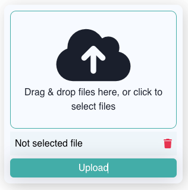

# Overview

This project allows Qodly Studio developers to use their own HTTP handlers to upload files to a server or send them to an S3 bucket (or similar services).



## Features

- **Customizable File Upload**: Easily configure the component to work with any backend service.
- **Drag and Drop Support**: Users can drag files directly into the DropZone for quick uploads.
- **Multiple File Selection**: Supports uploading multiple files at once.
- **File Type and Size Filtering**: Customize accepted file types and size limits to ensure valid uploads.

## Properties

| **Property Name** | **Type** | **Description**                                                                    |
| ----------------- | -------- | ---------------------------------------------------------------------------------- |
| **URL**           | `String` | The API endpoint or HTTP handler URL to which files are uploaded.                  |
| **Allowed Files** | `String` | Specifies the types of files allowed for upload (e.g., image/\*).                  |
| **File Limit**    | `Number` | Limits the number of files that can be uploaded. If set to `0`, there is no limit. |

## Events

| **Event Name**        | **Event data**    | **Description**                                       |
| --------------------- | ----------------- | ----------------------------------------------------- |
| **On Upload**         | File information  | Triggered when the upload process is initiated.       |
| **On Upload Success** | API response data | Triggered when the file upload is successful.         |
| **On Upload Failure** | API error message | Triggered when the file upload fails.                 |
| **On File Select**    | File information  | Triggered when a file or multiple files are selected. |
| **On File Remove**    | File information  | Triggered when a file is removed from the selection.  |

### How to Get Event Data

To access event data during an event, you can bind it to a function. Here’s an example:

```javascript
  var event : object
  var data : object

  event = webEvent
  data = event.data
```

For more information on working with event data, see the [Qodly web event documentation](https://developer.qodly.com/docs/language/commands/webEvent).

## Translation Support

DropZone supports Qodly i18n translations for its runtime text. To translate the component, add the following keys to your `i18n.json` file:

```json
{
  "dropZoneUpload": {
    "default": "Upload",
    "en": "Upload",
    "fr": "Téléverser",
    "es-ES": "Subir",
    "de": "Hochladen",
    "pt": "Carregar",
    "nl-NL": "Uploaden"
  },
  "dropZoneDropFilesHere": {
    "default": "Drop files here...",
    "en": "Drop files here...",
    "fr": "Déposez les fichiers ici...",
    "es-ES": "Suelta los archivos aquí...",
    "de": "Dateien hier ablegen...",
    "pt": "Solte os arquivos aqui...",
    "nl-NL": "Zet bestanden hier neer..."
  },
  "dropZoneDragAndDropFiles": {
    "default": "Drag & drop files here, or click to select files",
    "en": "Drag & drop files here, or click to select files",
    "fr": "Glissez-déposez les fichiers ici, ou cliquez pour sélectionner des fichiers",
    "es-ES": "Arrastra y suelta archivos aquí, o haz clic para seleccionar archivos",
    "de": "Dateien hierher ziehen und ablegen oder klicken, um Dateien auszuwählen",
    "pt": "Arraste e solte arquivos aqui ou clique para selecionar arquivos",
    "nl-NL": "Sleep bestanden hierheen of klik om bestanden te selecteren"
  },
  "dropZoneNoSelectedFile": {
    "default": "Not selected file",
    "en": "Not selected file",
    "fr": "Aucun fichier sélectionné",
    "es-ES": "Ningún archivo seleccionado",
    "de": "Keine Datei ausgewählt",
    "pt": "Nenhum arquivo selecionado",
    "nl-NL": "Geen bestand geselecteerd"
  },
  "dropZoneUploadSuccessful": {
    "default": "Upload successful!",
    "en": "Upload successful!",
    "fr": "Téléversement réussi !",
    "es-ES": "¡Subida correcta!",
    "de": "Upload erfolgreich!",
    "pt": "Carregamento bem-sucedido!",
    "nl-NL": "Upload geslaagd!"
  },
  "dropZoneUploadFailed": {
    "default": "Upload failed. Please try again.",
    "en": "Upload failed. Please try again.",
    "fr": "Le téléversement a échoué. Veuillez réessayer.",
    "es-ES": "La subida falló. Inténtalo de nuevo.",
    "de": "Upload fehlgeschlagen. Bitte versuchen Sie es erneut.",
    "pt": "Falha no carregamento. Tente novamente.",
    "nl-NL": "Upload mislukt. Probeer het opnieuw."
  },
  "dropZoneFileLimitExceeded": {
    "default": "You can only upload up to {fileLimit} files.",
    "en": "You can only upload up to {fileLimit} files.",
    "fr": "Vous pouvez téléverser jusqu'à {fileLimit} fichiers.",
    "es-ES": "Solo puedes subir hasta {fileLimit} archivos.",
    "de": "Sie können nur bis zu {fileLimit} Dateien hochladen.",
    "pt": "Você só pode carregar até {fileLimit} arquivos.",
    "nl-NL": "U kunt maximaal {fileLimit} bestanden uploaden."
  },
  "dropZoneFileSizeLimitExceeded": {
    "default": "File \"{fileName}\" exceeds the size limit of {fileSizeLimit} MB.",
    "en": "File \"{fileName}\" exceeds the size limit of {fileSizeLimit} MB.",
    "fr": "Le fichier \"{fileName}\" dépasse la limite de taille de {fileSizeLimit} Mo.",
    "es-ES": "El archivo \"{fileName}\" supera el límite de tamaño de {fileSizeLimit} MB.",
    "de": "Die Datei \"{fileName}\" überschreitet die Größenbeschränkung von {fileSizeLimit} MB.",
    "pt": "O arquivo \"{fileName}\" excede o limite de tamanho de {fileSizeLimit} MB.",
    "nl-NL": "Bestand \"{fileName}\" overschrijdt de maximale grootte van {fileSizeLimit} MB."
  }
}
```

The `{fileLimit}`, `{fileName}`, and `{fileSizeLimit}` placeholders are replaced automatically by the component.

## Custom CSS



```CSS
/* General Styles for DropZone */
self .dropZoneHeader {
  flex: 1;
  width: 100%;
  border: 1px solid #43ada8;
  border-radius: 10px;
  display: flex;
  align-items: center;
  justify-content: center;
  flex-direction: column;
}

self .dropZoneHeader:hover {
  background-color: #43ada80F;
}

self .dropZoneHeader p {
  text-align: center;
}

self .dropZoneFooter {
  background-color: #43ada80F;
  width: 100%;
  min-height: 40px;
  max-height: fit-content;
  padding: 8px;
  border-radius: 0px;
  cursor: pointer;
  display: flex;
  align-items: center;
  flex-direction: column;
  color: black;
  border: none;
}

.dropZoneFooter > div {
  display: flex;
  justify-content: space-between;
  gap: 10px;
  width: 100%;
}

.dropZoneFooter > div > p {
  white-space: nowrap;
  overflow: hidden;
  text-overflow: ellipsis;
}

```

Feel free to adjust any part to better fit your project's specifics!
